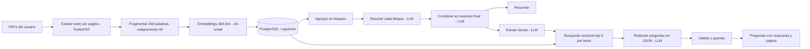
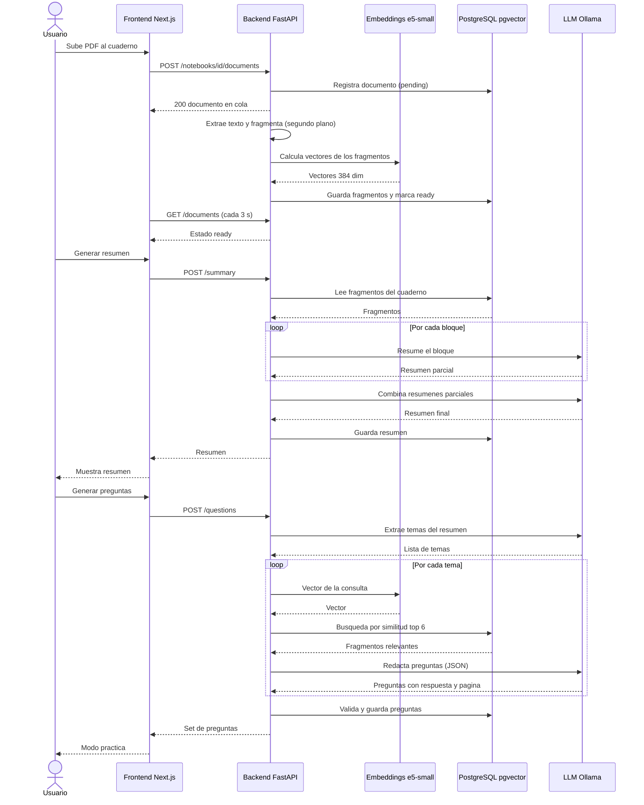

# StudyNotebook: resúmenes y preguntas de parcial con RAG 

**Autores:** Laura Marín - Fabian Buritica - Mateo Sepulveda - David Mendiola Rios

---

## 1. Introducción

Prepararse para un parcial implica leer mucho material, resumirlo y practicar con preguntas. Herramientas como NotebookLM automatizan parte de ese proceso, pero dependen de servicios en la nube: el material del estudiante sale de su equipo, hay límites de uso y el funcionamiento no es reproducible ni inspeccionable.

**StudyNotebook** es una aplicación web que corre completamente en local. El estudiante sube sus PDFs de estudio y obtiene un resumen para el parcial y preguntas tipo parcial con respuesta y explicación. Usa RAG : el material se indexa por significado y un modelo de lenguaje redacta el contenido apoyándose solo en los fragmentos recuperados.


## 2. Objetivo

**General:** construir una herramienta local que genere automáticamente resúmenes y preguntas de parcial verificables a partir de material de estudio en PDF.

**Específicos:**

1. Indexar PDFs con trazabilidad de página: 100 % de los fragmentos almacenados con su número de página y su vector.
2. Generar un resumen único por cuaderno que cubra todo el material cargado.
3. Generar un set de preguntas (selección múltiple, verdadero/falso y abiertas) donde al menos el 80 % esté sustentado por la página que cita (se mide en la sección 6).

## 3. Descripción de los datos

**Fuente:** los datos son los PDFs que sube el usuario. Para el desarrollo y las pruebas se usaron documentos de ejemplo como el material de la materia "Introduccion a la inteligencia artificial".

| Elemento | Descripción |
|---|---|
| Formato de entrada | PDF con texto (no escaneado) |
| Unidad de procesamiento | Fragmento (*chunk*) de ~250 palabras con 40 de solapamiento |
| Metadatos por fragmento | Texto, número de página, cuaderno y documento |
| Representación | Vector de 384 dimensiones (`intfloat/multilingual-e5-small`) |
| Salida: resumen | Texto Markdown, uno por generación |
| Salida: preguntas | Tipo (`multiple`, `vf`, `abierta`), enunciado, opciones (JSONB), respuesta, explicación, página |

**Preprocesamiento:** extracción de texto página por página con PyMuPDF, fragmentación con solapamiento, descarte de fragmentos de menos de 30 caracteres y normalización de los vectores.

**Limitaciones y sesgos conocidos**

- Los PDFs escaneados (solo imagen) no se procesan.
- Con varios PDFs en un cuaderno, la página citada no indica de qué archivo viene.
- Las presentaciones generan fragmentos cortos (una diapositiva por fragmento), con menos contexto que un texto corrido.
- El modelo de lenguaje puede heredar sesgos y cometer errores factuales.

**Licencias y restricciones:** el material cargado pertenece al usuario y no se comparte con terceros, porque todo se procesa en local. Conviene no subir material con derechos de autor que no se pueda usar. Los modelos se descargan con sus licencias propias (`multilingual-e5-small` y `qwen2.5:7b`; verifica los términos vigentes en sus páginas oficiales).

## 4. Metodología

**Etapas**

1. **Ingesta:** extracción de texto por página, fragmentación, cálculo de embeddings y almacenamiento en PostgreSQL con pgvector. Corre en segundo plano.
2. **Resumen (map-reduce):** los fragmentos se agrupan en bloques de ~10 000 caracteres, se resume cada bloque y luego se combinan los resúmenes parciales en uno final.
3. **Preguntas (RAG):** del resumen se extraen los temas más evaluables; por cada tema se recuperan los 6 fragmentos más similares y el LLM redacta las preguntas en JSON, que se valida antes de guardarse.
4. **Práctica:** la interfaz muestra las preguntas, permite responder y revela la respuesta, la explicación y la página.

**Justificación de las decisiones**

| Decisión | Justificación |
|---|---|
| Map-reduce para el resumen | Un resumen debe cubrir todo el material; la búsqueda por similitud solo trae unos pocos fragmentos |
| RAG para las preguntas | Cada pregunta debe anclarse a un pasaje concreto y citable |
| PostgreSQL + pgvector | Una sola base para datos relacionales y vectores; búsqueda aproximada rápida |
| Fragmentos de 250 palabras, solapamiento de 40 | Equilibrio entre precisión de recuperación y contexto; el solapamiento evita cortar ideas |
| `multilingual-e5-small` | Embeddings multilingües (español), gratuitos y locales; 512 tokens de entrada |
| Ollama con `qwen2.5:7b` (`num_ctx` = 8192) | LLM local y privado; el contexto ampliado evita que Ollama recorte los bloques |
| Salida JSON con validación y un reintento | Los modelos pequeños a veces añaden texto extra al JSON |
| Capa `llm.py` con interruptor | Permite cambiar a la API de Claude sin tocar el resto del código |


### Diagrama de flujo metodológico



## 5. Diagrama de interacción (UML)

Interacción del sistema en uso: subida de un PDF, generación del resumen y de las preguntas.



## 6. Resultados


## 7. Reproducibilidad

**Requisitos:** Docker Desktop, Ollama instalado en la máquina y ~10 GB de disco libre.

**Ejecución**

```bash
git clone https://github.com/lauramarin15/study_notebook.git && cd studynotebook
ollama pull qwen2.5:7b
cp .env.example .env
docker compose up --build
```

La primera construcción tarda entre 10 y 20 minutos (descarga de PyTorch). Luego abre:

| Servicio | URL |
|---|---|
| Interfaz | http://localhost:3000 |
| API y documentación | http://localhost:8000/docs |
| Estado | http://localhost:8000/health |

Comandos útiles: `docker compose logs -f backend` (logs), `docker compose down -v` (detener y borrar la base de datos), `ollama ps` (ver si el modelo está activo).

**Solución de problemas frecuentes**

- `Could not resolve authentication method`: falta `LLM_PROVIDER=ollama` en `.env`; luego `docker compose up -d --force-recreate`.
- Archivo en `failed` con "No se pudo extraer texto": PDF escaneado.
- `init.sql` no se aplica: Postgres solo lo ejecuta al crear el volumen (`docker compose down -v`).

**Estructura del repositorio**

```
studynotebook/
├── docker-compose.yml
├── .env.example
├── db/init.sql               # esquema (6 tablas + pgvector)
├── backend/
│   ├── Dockerfile
│   ├── requirements.txt
│   └── app/
│       ├── main.py           # endpoints
│       ├── db.py             # conexión
│       ├── embeddings.py     # modelo de embeddings
│       ├── ingest.py         # extracción, fragmentación, indexado
│       ├── llm.py            # cliente LLM (Ollama / Claude)
│       └── generate.py       # resumen y preguntas
└── frontend/                 # Next.js
    └── app/
```

## Limitaciones y trabajo futuro

- Sin OCR, solo PDF, sin autenticación (uso local de una persona).
- La generación es síncrona y la ingesta usa `BackgroundTasks`, que no es una cola durable.
- Mejoras: cola de tareas, verificación automática de cada pregunta contra su fragmento fuente, nombre del archivo en cada cita, soporte para Word y PowerPoint, y calificación de respuestas abiertas con el LLM.
